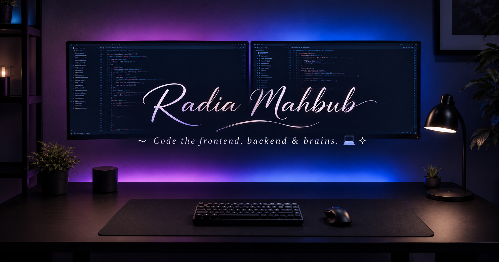

 

 

---

## 👩🏻‍💻 About Me

* 💻 Full-stack developer working with web technologies and application development.
* 🌱 Strengthening my skills in Python, Django, and backend engineering.
* ⚙️ Interested in REST APIs, database design, and software architecture.
* 🤖 Exploring AI and its practical applications in software development.
* 🎯 Working toward building reliable, useful, and intelligent applications.

> 〜 𝐂𝐨𝐝𝐞 𝐭𝐡𝐞 𝐟𝐫𝐨𝐧𝐭𝐞𝐧𝐝, 𝐛𝐚𝐜𝐤𝐞𝐧𝐝 & 𝐛𝐫𝐚𝐢𝐧𝐬. 💻✧

## 🛠️ Tech Stack

**Languages**

**Frameworks & Libraries**

**Databases & Tools**

## 🚀 Featured Projects

### 📚 Library Management System

A Django project for managing library records and practicing CRUD operations, forms, templates, and database relationships.

**Technologies:** Python · Django · SQLite

### 🎓 Learning Management System

A web-based platform for managing students, trainers, and administrative workflows.

**Technologies:** PHP · Laravel · MySQL

### 🛒 Django E-commerce

A learning project focused on building a full-stack e-commerce application with a structured backend and modern frontend.

**Technologies:** Python · Django · PostgreSQL · React

<!-- Replace the project descriptions with links to your actual repositories when ready. -->

## 📊 GitHub Statistics

 

## 🌱 Currently Learning

* Django REST Framework and API development
* Authentication, authorization, and application security
* Software architecture, testing, and maintainable code
* Practical AI integration in full-stack applications

## 🤝 Connect With Me

---

*Learn continuously. Build thoughtfully. Improve consistently.*

**〜 Code the frontend, backend & brains. 💻✧**

